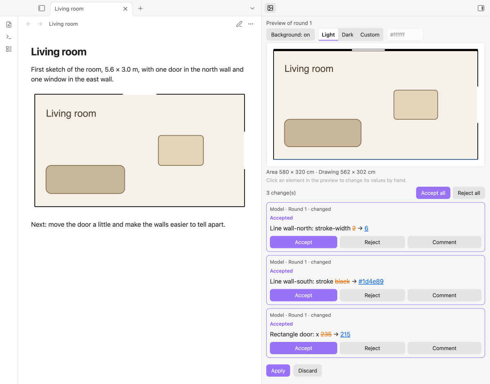
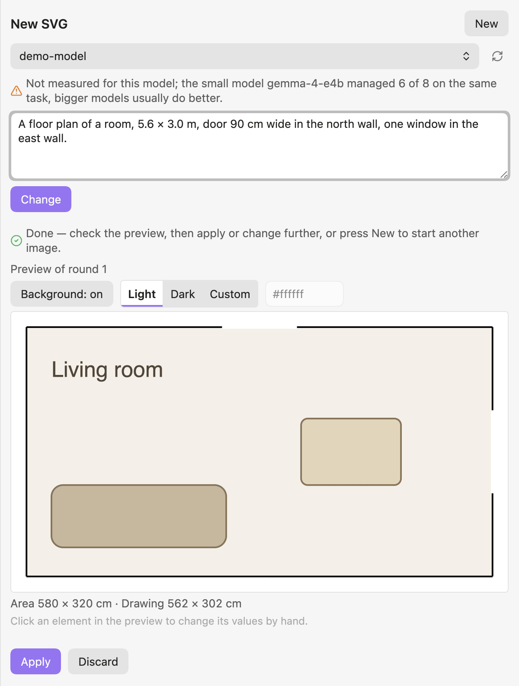
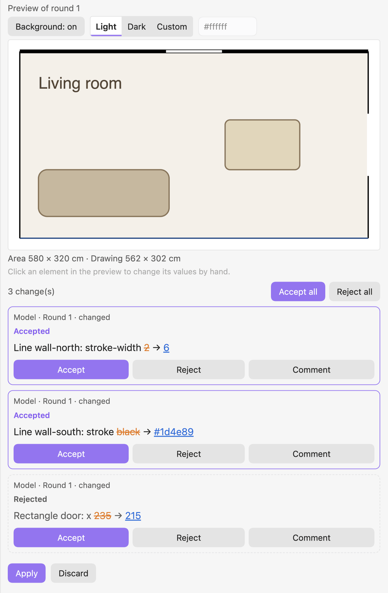
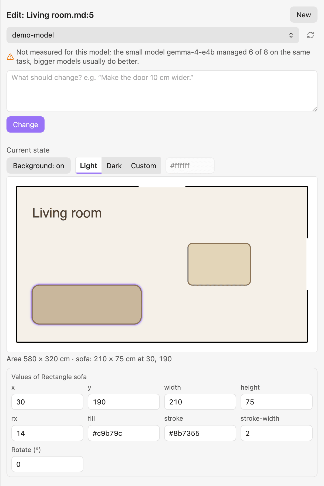
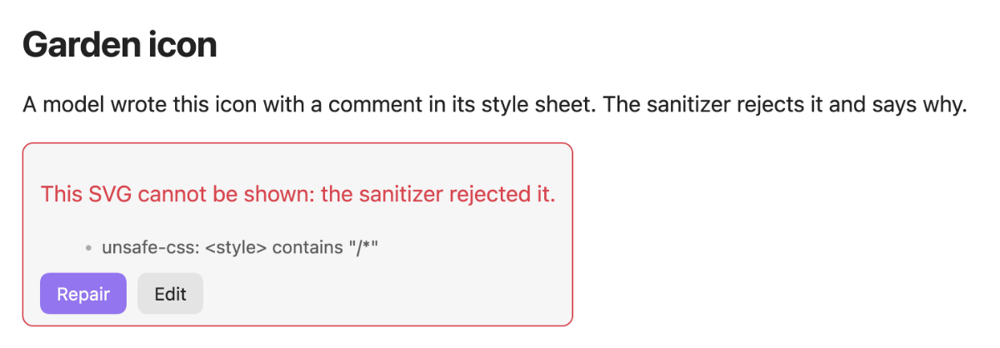

# SVG Studio

> 🇬🇧 English · [🇩🇪 Deutsch](README.de.md)

**Describe an icon, logo, diagram or floor plan in words and get an exact, editable SVG in your note — then refine it in rounds, by prompt or by changing single numbers, and accept or reject each change to a single element.**

[](LICENSE)
[](LICENSE-DOCS)
[](https://git.jkaindl.de/jkaindl/svg-studio/releases)


A language model writes the SVG; SVG Studio keeps it exact. The SVG itself is the source (no private drawing language), every change is a replacement of a span of text against the current text, and what you did not ask to change stays byte for byte the same. It works with a local or any OpenAI-compatible model and carries no keys of its own.

<p align="center"></p>

## Features

- **Create from words** — describe an icon, a diagram or a floor plan with measurements and get a sanitized SVG with a preview and a measure line.



- **Refine in rounds** — each answer is a round; every changed element is a card you accept or reject on its own, with a comment that goes to the model with your next request.



- **Edit numbers by hand** — click an element in the preview and change its coordinates, size, colours, text, position or rotation without a model.



- **Exact and byte-faithful** — changes are applied all or nothing against the current text and read back; a hand edit is never lost.
- **Safe by construction** — another tool's SVG is parsed and sanitized before it is drawn; the sanitizer rejects instead of silently removing parts.
- **Works on what you have** — open an `.svg` file, an `svg-studio` code block or an embedded `![[name.svg]]`; repair an SVG from Inkscape or give every element a name, with or without a model.



- **Apply as file or block** — a new SVG becomes a file in your attachment folder (with its link at the cursor) or a code block in the note.

## Requirements

- **Obsidian 1.11.4+** (desktop and mobile).
- **A language model**: an OpenAI-compatible endpoint (for example a local server) set up in the plugin [LLM Endpoint Manager](https://github.com/johannes-kaindl/llm-endpoint-manager) or in this plugin's own settings. Small models work, larger ones are more reliable; the panel shows measured results for models that were tested.

## Install

### Community Plugins

> Not yet in the community directory. Until the review is through, use one of the other ways below; afterwards: Settings → Community plugins → Browse → „SVG Studio“.

### Manual

Put `main.js`, `manifest.json` and `styles.css` from the [latest release](https://git.jkaindl.de/jkaindl/svg-studio/releases) into `<vault>/.obsidian/plugins/svg-studio/`, then enable the plugin.

### BRAT (beta)

Add the GitHub mirror `johannes-kaindl/svg-studio` in [BRAT](https://github.com/TfTHacker/obsidian42-brat).

### From source

```bash
git clone https://git.jkaindl.de/jkaindl/svg-studio
cd svg-studio && npm install && npm run build
# main.js manifest.json styles.css → <vault>/.obsidian/plugins/svg-studio/
```

## Usage

1. Set up a language model (see Requirements).
2. Run the command **SVG Studio: New SVG**; the panel opens in the right sidebar.
3. Describe the image („A moon icon, 48 × 48, flat, one colour.“) and press **Create**.
4. Check the preview, change it with another request or by hand, then press **Apply**.

To change an SVG later, put the cursor in an `svg-studio` block or on an embedded `.svg` and run **SVG Studio: Edit SVG**, or use the **Edit** button on the block or the embed. More in [Getting started](https://github.com/johannes-kaindl/svg-studio/blob/main/docs/README.md#getting-started).

### Configuration

| Setting | Effect | Default |
|---|---|---|
| Apply new SVG as | Where **Apply** puts an SVG created from scratch: a file in the attachment folder, a code block at the cursor, or ask every time. | File in the attachment folder |
| Show SVG in notes automatically | Off: a button instead of the image, so a drawing that freezes Obsidian can be edited or removed without opening it. | On |
| Language model | Endpoint, model and request settings (from LLM Endpoint Manager, if installed). | — |

## How it works

The model answers with an SVG, or with a list of changes keyed by element `id`. SVG Studio checks the answer (well-formed, accepted by the sanitizer), shows it as a round, and writes only what you accept — through one path that re-reads the text of the target first and refuses to write if it changed in the meantime. In the panel only the checked tree is inserted, into an isolated shadow root; in a note the checked SVG is shown as an image. Architecture and decisions: [`docs/internal/architecture.md`](https://github.com/johannes-kaindl/svg-studio/blob/main/docs/internal/architecture.md).

### Known limits

- **Drawing cost is an estimate, not a protection.** The sanitizer estimates how long an SVG takes to draw and rejects what is clearly too much (`too-costly`); a block that costs a quarter of the limit or more is drawn only after a click. The estimate was measured in Chromium and misses whole classes (shapes and clips set by CSS, large colour emoji, gradients with thousands of stops, CSS animations); WebKit (iOS) and Firefox were not measured, and a phone is probably several times slower than the measuring machine. What actually protects Obsidian is the safety net: a mark is written before an SVG is drawn, a watchdog notices a frozen window, and a block that froze Obsidian waits for a click the next time. It cannot catch a freeze shorter than about one second or one that starts late; a switch in the settings turns off automatic drawing in notes. SVGs embedded with `![[name.svg]]` are drawn by Obsidian itself and are not covered.
- **Model quality varies.** The panel prints what was measured for a model; for models that were not measured it says so.

## Documentation

- [Documentation](https://github.com/johannes-kaindl/svg-studio/blob/main/docs/README.md) — start here, organised after Diátaxis.
- [Getting started](https://github.com/johannes-kaindl/svg-studio/blob/main/docs/README.md#getting-started) — from installation to your first SVG.
- [Troubleshooting](https://github.com/johannes-kaindl/svg-studio/blob/main/docs/README.md#troubleshooting) — something not working? Start here; it ends with where to get help.

## Contributing

Issues and pull requests on [git.jkaindl.de](https://git.jkaindl.de/jkaindl/svg-studio). Test-driven (`npm run gate`: lint, typecheck, tests, purity and bundle checks). See [`AGENTS.md`](AGENTS.md).

## License

- **Code:** AGPL-3.0-or-later ([`LICENSE`](LICENSE); dual-license option in [`LICENSING.md`](LICENSING.md)).
- **Docs/Text:** CC BY-SA 4.0 ([`LICENSE-DOCS`](LICENSE-DOCS)).

Copyright © 2026 Johannes Kaindl.
